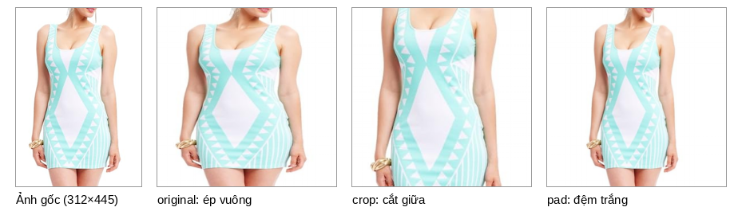

# MagicLens: truy xuất ảnh với chỉ dẫn mở (bản thực nghiệm cho BTL Xử lý ảnh)

Thư mục này là bản sao mã nguồn chính thức của **MagicLens**
([google-deepmind/magiclens](https://github.com/google-deepmind/magiclens), commit `5135f58`),
viết bằng JAX/Flax. Bản sao này được dùng cho bài tập lớn môn Xử lý ảnh với ba mục tiêu:

1. **Tái lập** kết quả của paper trên benchmark FashionIQ (tác vụ dress).
2. **Phần A: thử ba cải tiến không cần huấn luyện** (tiền xử lý ảnh, cách viết truy vấn,
   rerank) và đánh giá chúng theo quy trình dev/test tách biệt (mục 7–8).
3. **Phần B: tinh chỉnh khối hợp nhất** trên tập train của FashionIQ, giữ nguyên backbone
   CLIP, rồi đánh giá theo cùng quy trình (mục 9).

Paper: Kai Zhang và cộng sự, *MagicLens: Self-Supervised Image Retrieval with Open-Ended
Instructions*, ICML 2024 ([arXiv:2403.19651](https://arxiv.org/abs/2403.19651),
[trang dự án](https://open-vision-language.github.io/MagicLens/)).

**Kết quả chính:**
- Baseline tái lập sát với paper: R@10 21.8, R@50 43.4 (paper: 21.5 / 41.3).
- Phần A ([mục 8](#8-kết-quả-phần-a-fashioniq-dress-magiclens-b-bản-clip)): cả ba cải tiến
  **không tạo ra mức tăng có ý nghĩa thống kê**. Cấu hình tốt nhất tăng R_avg 0.5 điểm, khoảng
  tin cậy 95% là [−0.5, +1.6].
- Phần B ([mục 9](#9-phần-b-tinh-chỉnh-khối-hợp-nhất-trên-fashioniq-train)): tinh chỉnh tăng
  R@10 trên test từ 23.3 lên 34.2 và R_avg từ 32.7 lên 46.0, tức **+13.3 điểm, khoảng tin cậy
  95% là [+11.2, +15.5]**. Đổi lại, mô hình không còn là zero-shot.

---

## 1. Giới thiệu MagicLens

- **Bài toán:** truy vấn gồm một ảnh và một câu chỉ dẫn bằng văn bản (ví dụ ảnh một chiếc váy
  kèm câu "ngắn hơn và màu đỏ"); mô hình tìm ảnh phù hợp trong kho.
- **Ý tưởng chính:** hai ảnh xuất hiện trên cùng một trang web thường có quan hệ ngữ nghĩa
  với nhau. Tác giả dùng LMM và LLM để diễn đạt quan hệ đó thành câu chỉ dẫn, tạo ra
  36.7 triệu bộ ba (ảnh truy vấn, chỉ dẫn, ảnh đích) mà không cần gán nhãn thủ công.
- **Mô hình:** bộ mã hóa ảnh và văn bản của CLIP (hoặc CoCa) cho hai embedding `v`, `t`;
  chuỗi `[v, t]` đi qua 4 lớp self-attention và một lớp attention pooling để ra một
  embedding duy nhất. Ảnh trong kho được mã hóa kèm văn bản rỗng `""`, và truy xuất bằng
  độ tương đồng cosine.
- **Kết quả của paper:** tương đương hoặc tốt hơn các phương pháp tốt nhất trước đó trên
  8 benchmark, với số tham số nhỏ hơn tới 50 lần.


Lưu ý: mã nguồn chính thức **chỉ hỗ trợ suy luận** (chưa có code huấn luyện). Checkpoint
công bố chỉ có bản CLIP (`base`, `large`) và đã được chuyển đổi trọng số; không có bản CoCa.
Code tinh chỉnh ở Phần B (`fiq_finetune.py`) được viết thêm cho bài tập này. Nó chỉ học lại
khối hợp nhất trên FashionIQ, không thay thế quy trình huấn luyện gốc trên 36.7 triệu bộ ba.

## 2. Cấu trúc thư mục

| Tệp / thư mục | Vai trò | Trạng thái |
|---|---|---|
| `model.py` | Lớp `MagicLens`. Có thêm `encode_image`, `encode_text`, `fuse` (tách `__call__` thành ba bước để cache được phần nặng); kết quả trùng khớp tuyệt đối với bản gốc | Đã sửa |
| `layers.py` | Các lớp Transformer, attention pooling | Giữ nguyên |
| `data_utils.py` | Đọc dữ liệu FIQ/CIRCO/DTIN, tính Recall. Bỏ qua ảnh FIQ bị thiếu; `process_img` có thêm tham số `mode` | Đã sửa |
| `inference.py` | Script đánh giá gốc. Xóa ký tự thừa ở dòng 1 (gây lỗi `NameError`); dùng tệp BPE có sẵn trong gói `clip` thay vì tải lại mỗi lần chạy | Đã sửa |
| `download_fiq_images.py` | Tải ảnh FashionIQ từ đường dẫn Amazon gốc | Mới |
| `fiq_experiments.py` | Phần A: thí nghiệm ba cải tiến không cần huấn luyện và ablation | Mới |
| `fiq_finetune.py` | Phần B: tinh chỉnh khối hợp nhất trên tập train FashionIQ | Mới |
| `data/` | Dữ liệu benchmark (xem [data/README.md](data/README.md)) | |
| `models/` | Checkpoint MagicLens | |
| `cache/` | Embedding CLIP đã tính: tập val do `fiq_experiments.py` tạo, tập train do `fiq_finetune.py` tạo | Tự sinh |
| `output/` | Bảng kết quả và hình minh họa | Tự sinh |

## 3. Cài đặt

Môi trường đã kiểm thử:

| Thành phần | Phiên bản |
|---|---|
| Hệ điều hành | Linux (Ubuntu), chỉ dùng CPU: Intel Core i5-7200U (2 nhân, 4 luồng), 15 GB RAM |
| Python | 3.12.3 |
| jax / jaxlib | 0.11.1 (bản CPU) |
| flax / optax | 0.12.9 / 0.2.8 |
| scenic | 0.0.1 (cài từ GitHub) |
| tensorflow-cpu | 2.21.0 |
| clip (OpenAI) | 1.0, cài **không kèm torch** (chỉ dùng tokenizer) |
| numpy / pillow | 2.5.3 / 12.3.0 |

Các bước cài đặt, theo hướng dẫn gốc:

```bash
python3 -m venv .venv
source .venv/bin/activate
git clone https://github.com/google-research/scenic.git
pip install ./scenic
pip install -r scenic/scenic/projects/baselines/clip/requirements.txt
# Gói clip chỉ cần cho tokenizer; nếu pip đòi cài torch thì cài không kèm phụ thuộc:
pip install --no-deps git+https://github.com/openai/CLIP.git
pip install ftfy regex
# Có GPU thì cài jax bản CUDA theo https://jax.readthedocs.io/en/latest/installation.html
```

> **Lưu ý:** nếu di chuyển thư mục dự án sau khi tạo venv, lệnh `source .venv/bin/activate`
> và `pip` sẽ trỏ về đường dẫn cũ. Khi đó hãy gọi thẳng `.venv/bin/python ...` (như các lệnh
> bên dưới) hoặc tạo lại venv.

## 4. Tải mô hình

```bash
# Cần đăng nhập gcloud (tài khoản Gmail bất kỳ):
gsutil cp -R gs://gresearch/magiclens/models ./
```

Hoặc tải từ [Google Drive](https://drive.google.com/drive/folders/1MXszMqIIh-yV7cYxWUxP7uHs9gfuTT3u).
Đặt tệp vào `models/magic_lens_clip_base.pkl` (khoảng 666 MB) hoặc
`models/magic_lens_clip_large.pkl`.

## 5. Chuẩn bị dữ liệu FashionIQ

1. Tải `captions/` và `image_splits/` của FashionIQ vào `data/fiq/` theo
   [data/README.md](data/README.md).
2. Tải ảnh từ đường dẫn Amazon gốc:

   ```bash
   .venv/bin/python download_fiq_images.py --subtasks dress                # tập val
   .venv/bin/python download_fiq_images.py --subtasks dress --split train  # tập train, chỉ Phần B cần
   ```

   Script chạy lại an toàn: ảnh đã có sẽ được bỏ qua. Đường dẫn chết được ghi vào
   `data/fiq/missing.dress.<split>.txt`.

Một phần đường dẫn đã chết. Ảnh thiếu bị loại, và truy vấn nào có ảnh truy vấn hoặc ảnh đích
bị thiếu cũng bị bỏ qua:

| Tập dress | Ảnh tải được | Truy vấn giữ lại |
|---|---|---|
| val (kho ảnh và truy vấn để đánh giá) | **3653/3817** (thiếu 4.3%) | **1861/2017** |
| train (chỉ dùng ở Phần B) | **10878/11452** (thiếu 5.0%) | **5441/5985** |

Hai tập không có ảnh chung và không có cặp (ảnh truy vấn, ảnh đích) nào trùng nhau.

CIRCO và DTIN: xem [data/README.md](data/README.md).

## 6. Chạy baseline bằng `inference.py`

```bash
.venv/bin/python inference.py \
  --model_size base \
  --model_path ./models/magic_lens_clip_base.pkl \
  --dataset fiq-dress \
  --batch_size 64
```

- Với FIQ, script in ra R@10 và R@50. Với CIRCO, script ghi kết quả ra JSON để nộp lên server
  đánh giá (nhãn tập test không công khai).
- `--batch_size` mặc định là 1024, chỉ phù hợp GPU/TPU; trên CPU nên dùng 32–64.
- Script nạp **toàn bộ ảnh vào RAM** (khoảng 0.6 MB mỗi ảnh). FIQ cần vài GB, nhưng CIRCO
  (123 403 ảnh) cần khoảng 74 GB, nên không chạy được trên máy cá nhân nếu không sửa code.

Các số baseline ở mục 8 được tính bằng `fiq_experiments.py`. Script này dùng cùng hàm tiền xử
lý, cùng câu truy vấn và cùng mô hình như `inference.py`; phần tách mô hình (`fuse`) đã được
kiểm tra cho kết quả trùng khớp tuyệt đối với `model.apply` gốc.

## 7. Phần A: cải tiến không cần huấn luyện (`fiq_experiments.py`)

### 7.1. Ba cải tiến được thử

1. **Tiền xử lý ảnh** (`process_img(..., mode=...)` trong `data_utils.py`):
   - `original`: chia cho giá trị điểm ảnh lớn nhất của chính ảnh, rồi ép thẳng về 224×224
     (cách của mã gốc; làm méo ảnh không vuông).
   - `crop`: chia cho 255, cắt hình vuông lớn nhất ở giữa, rồi resize.
   - `pad`: chia cho 255, đệm trắng thành hình vuông, rồi resize (giữ tỉ lệ và toàn bộ vật thể).

   Lý do thử: **87.2% ảnh dress là ảnh dọc** (tỉ lệ cao/rộng trung vị 1.30). Chỉ 2/3653 ảnh có
   điểm ảnh sáng nhất dưới 255, nên "chia cho max" và "chia cho 255" gần như không khác nhau;
   vì vậy không tách riêng thành một biến thể.

   

2. **Cách viết truy vấn.** Mỗi truy vấn FIQ có hai câu mô tả `c1`, `c2`. Thử bốn mẫu câu và
   phương án gộp (lấy trung bình embedding đã chuẩn hóa của cả bốn):
   - `and`: `"{c1} and {c2}"` (cách của mã gốc)
   - `swap`: `"{c2} and {c1}"`
   - `that`: `"a dress that {c1} and {c2}"`
   - `same`: `"same dress but {c1} and {c2}"`

3. **Rerank top-K** (mặc định K = 100), chấm lại điểm của K ứng viên đầu:

   ```
   điểm mới = z(s_MagicLens) + λ · z(cos(văn bản, ảnh ứng viên)) + μ · z(cos(ảnh truy vấn, ảnh ứng viên))
   ```

   `z(·)` chuẩn hóa điểm về trung bình 0, độ lệch chuẩn 1 trên K ứng viên của mỗi truy vấn.
   Hai điểm bổ sung lấy từ chính backbone CLIP bên trong MagicLens. λ và μ được dò trên
   lưới {0, 0.1, …, 1.0}.

### 7.2. Quy trình đánh giá

- Chia ngẫu nhiên các truy vấn thành hai nửa (seed 0): **dev 930** và **test 931**.
- Lần lượt chọn tiền xử lý, rồi cách viết truy vấn, rồi trọng số rerank. Mỗi lựa chọn dựa
  trên **R_avg = (R@10 + R@50) / 2 của dev** (độ đo tổng hợp thường dùng cho FashionIQ).
  **Số báo cáo là của test**, nên không bị lạc quan do chọn cấu hình.
- Độ tin cậy được ước lượng bằng **bootstrap ghép cặp 2000 lần** trên tập test.
- Embedding CLIP (phần tốn thời gian) được cache trong `cache/fiq-dress-base/`. Tệp
  `meta.json` ghi lại danh sách ảnh và truy vấn: nếu dữ liệu thay đổi (ví dụ tải thêm ảnh),
  script sẽ dừng và báo cần xóa cache.

### 7.3. Cách chạy

```bash
# Lần đầu, chỉ tiền xử lý gốc: khoảng 33 phút trên CPU ở trên
.venv/bin/python fiq_experiments.py --subtask dress --modes original

# Thêm crop và pad (mỗi chế độ thêm khoảng 23 phút); khi đã có cache, chạy lại mất khoảng 45 giây
.venv/bin/python fiq_experiments.py --subtask dress
```

| Tham số | Mặc định | Ý nghĩa |
|---|---|---|
| `--model_size` | `base` | `base` hoặc `large` |
| `--model_path` | `./models/magic_lens_clip_base.pkl` | Đường dẫn checkpoint |
| `--subtask` | `dress` | `dress`, `shirt` hoặc `toptee` |
| `--modes` | `original crop pad` | Các cách tiền xử lý cần so sánh (bắt buộc có `original`) |
| `--data_dir` | `./data/fiq` | Thư mục dữ liệu FashionIQ |
| `--cache_dir` | `./cache` | Nơi lưu embedding |
| `--output` | `./output` | Nơi ghi kết quả |
| `--batch_size` | `32` | Kích thước batch khi mã hóa ảnh |
| `--rerank_k` | `100` | Số ứng viên được rerank |
| `--seed` | `0` | Seed chia dev/test |

Kết quả được ghi vào:
- `output/fiq-dress-base_experiments.md`: các bảng như ở mục 8.
- `output/fiq-dress-base_experiments.json`: toàn bộ số liệu, các lựa chọn, thời gian chạy, và
  danh sách top-10 của từng truy vấn test (dùng để vẽ ví dụ định tính).

## 8. Kết quả Phần A (FashionIQ dress, MagicLens-B bản CLIP)

Kho 3653 ảnh, 1861 truy vấn (dev 930 / test 931). Các cột "test" là kết quả báo cáo; cột
"dev R_avg" là tiêu chí dùng để chọn cấu hình.

### 8.1. Tái lập baseline

| | Dữ liệu | R@10 | R@50 |
|---|---|---|---|
| Paper (Bảng 12) | 2017 truy vấn, 3817 ảnh | 21.5 | 41.3 |
| Tái lập (checkpoint chuyển đổi) | 1861 truy vấn, 3653 ảnh | 21.8 | 43.4 |

Kết quả sát với paper. R@50 cao hơn một phần vì kho ảnh nhỏ hơn (thiếu 164 ảnh).

### 8.2. Tóm tắt: cộng dồn từng cải tiến

| Cấu hình | dev R_avg | test R@1 | test R@5 | test R@10 | test R@50 | test R_avg |
|---|---|---|---|---|---|---|
| Baseline (original, "and") | 32.5 | 8.1 | 17.8 | 23.3 | 42.1 | 32.7 |
| + Tiền xử lý: original (giữ nguyên) | 32.5 | 8.1 | 17.8 | 23.3 | 42.1 | 32.7 |
| + Truy vấn: swap | 33.0 | 7.6 | 18.0 | 22.8 | 42.1 | 32.4 |
| + Rerank top-100 (λ=0.6, μ=0.3) | 33.5 | 7.3 | 17.1 | 23.5 | 43.0 | 33.2 |

- Chênh lệch so với baseline trên test (khoảng tin cậy 95%): **R@10 +0.2 [−1.1, +1.6]**,
  **R_avg +0.5 [−0.5, +1.6]** điểm. Cả hai khoảng đều chứa 0, nên **không có ý nghĩa thống kê**.
- Xét top-10: 23 truy vấn được kéo vào nhưng 21 truy vấn bị đẩy ra (ròng +2/931). Xét top-50:
  31 vào, 23 ra (ròng +8/931).

### 8.3. Cải tiến 1: tiền xử lý ảnh (truy vấn "and")

| Cấu hình | dev R_avg | test R@1 | test R@5 | test R@10 | test R@50 | test R_avg |
|---|---|---|---|---|---|---|
| original (ép vuông) | 32.5 | 8.1 | 17.8 | 23.3 | 42.1 | 32.7 |
| crop (cắt giữa) | 31.6 | 7.5 | 16.0 | 21.1 | 41.9 | 31.5 |
| pad (đệm trắng) | 32.3 | 7.1 | 17.6 | 23.1 | 42.4 | 32.8 |

### 8.4. Cải tiến 2: cách viết truy vấn (tiền xử lý original)

| Cấu hình | dev R_avg | test R@1 | test R@5 | test R@10 | test R@50 | test R_avg |
|---|---|---|---|---|---|---|
| and: `"{c1} and {c2}"` | 32.5 | 8.1 | 17.8 | 23.3 | 42.1 | 32.7 |
| swap: `"{c2} and {c1}"` | 33.0 | 7.6 | 18.0 | 22.8 | 42.1 | 32.4 |
| that: `"a dress that {c1} and {c2}"` | 30.2 | 5.6 | 14.3 | 20.8 | 40.9 | 30.9 |
| same: `"same dress but {c1} and {c2}"` | 30.8 | 6.7 | 16.2 | 22.6 | 41.0 | 31.8 |
| Gộp cả bốn | 32.6 | 7.2 | 17.4 | 22.2 | 42.7 | 32.5 |

### 8.5. Cải tiến 3: rerank top-100 (original, swap)

| Cấu hình | dev R_avg | test R@1 | test R@5 | test R@10 | test R@50 | test R_avg |
|---|---|---|---|---|---|---|
| Không rerank | 33.0 | 7.6 | 18.0 | 22.8 | 42.1 | 32.4 |
| Chỉ văn bản → ảnh (λ tối ưu trên dev = 0) | 33.0 | 7.6 | 18.0 | 22.8 | 42.1 | 32.4 |
| Chỉ ảnh → ảnh (μ tối ưu trên dev = 0) | 33.0 | 7.6 | 18.0 | 22.8 | 42.1 | 32.4 |
| Cả hai (λ=0.6, μ=0.3) | 33.5 | 7.3 | 17.1 | 23.5 | 43.0 | 33.2 |

Trần của rerank: 51.8% truy vấn test có ảnh đích nằm trong top-100 của bước 1, nên về lý
thuyết rerank hoàn hảo có thể đưa R@10 lên tới 51.8.

### 8.6. Thăm dò thêm (chỉ trên dev)

Hai kỹ thuật rerank kinh điển của truy xuất ảnh là mở rộng truy vấn **α-QE** và tăng cường kho
ảnh **DBA** đã được thử bằng một script riêng (không nằm trong thư mục này), chỉ xem số trên
nửa dev. **Mọi cấu hình đều kém baseline**: tốt nhất α-QE đạt R_avg 31.4, DBA đạt 31.5, trong
khi baseline đạt 32.5. Vì vậy hai kỹ thuật này không được đưa vào quy trình chính.

### 8.7. Thời gian chạy (CPU i5-7200U, không GPU)

| Bước | Thời gian |
|---|---|
| Mã hóa ảnh | 0.36–0.40 s/ảnh (khoảng 23 phút cho 3653 ảnh, mỗi chế độ tiền xử lý) |
| Mã hóa văn bản | khoảng 0.07 s/câu (khoảng 2 phút cho mỗi mẫu câu) |
| Rerank | dưới 0.3 ms/truy vấn |
| Chạy lại toàn bộ khi đã có cache | khoảng 45 giây, RAM tối đa khoảng 2.9 GB |

### 8.8. Nhận xét

- **Tiền xử lý:** ảnh truy vấn và ảnh trong kho bị méo giống hệt nhau, nên thứ hạng tương đồng
  gần như giữ nguyên. Cắt giữa làm mất cổ áo và gấu váy (đúng những chi tiết câu mô tả hay
  nhắc tới), nên giảm 1.2 điểm R_avg. Đệm trắng giữ được trọn vật thể, nhưng chiếc váy chỉ
  còn chiếm khoảng 3/4 bề ngang khung 224 px, nên lợi ích bị triệt tiêu.
- **Cách viết truy vấn:** mô hình khá nhạy với cách viết (chênh tới 1.8 điểm R_avg trên test),
  nhưng cách nối câu gốc đã gần tốt nhất. Thêm chữ "dress" làm giảm hiệu năng, vì ảnh nào trong
  kho cũng là váy nên chữ này không giúp phân biệt.
- **Rerank:** hai điểm bổ sung lấy từ cùng backbone CLIP với MagicLens nên ít thông tin mới.
  Câu mô tả của FIQ mang tính tương đối ("tối hơn", "ngắn hơn"), nên điểm văn bản → ảnh đứng
  riêng rất yếu (trọng số tối ưu trên dev bằng 0). Kết hợp hai điểm chỉ tăng nhẹ và không có
  ý nghĩa thống kê.
- **Kết luận:** các thủ thuật zero-shot không cải thiện được MagicLens trên FashionIQ dress.
  Dư địa vẫn còn lớn (R@10 khoảng 23 so với 51.8% nằm trong top-100), nhưng cần nguồn thông tin
  mới. Phần B (mục 9) thử nguồn đó: tinh chỉnh riêng khối hợp nhất trên tập train của
  FashionIQ; khi đó kết quả không còn là zero-shot.

## 9. Phần B: tinh chỉnh khối hợp nhất trên FashionIQ train

Phần A cho thấy các thủ thuật zero-shot không đủ. Phần B dùng thêm dữ liệu có nhãn: giữ nguyên
backbone CLIP và chỉ học lại khối hợp nhất trên tập train của FashionIQ dress, bằng script
`fiq_finetune.py`. **Kết quả không còn là zero-shot** (mô hình đã thấy dữ liệu cùng miền với tập
đánh giá), nên không so trực tiếp với bảng zero-shot của paper.

### 9.1. Phương pháp

- **Phần được học:** 4 lớp self-attention (`multimodal_encoder`), lớp attention pooling
  (`contrastive_multimodal_pooler`) và nhiệt độ τ, tổng cộng 16.8M tham số. Backbone CLIP đóng
  băng, nên embedding CLIP của ảnh và câu train chỉ cần tính một lần rồi cache; mỗi bước huấn
  luyện chỉ chạy lại `MagicLens.fuse`.
- **Hàm mất mát:** InfoNCE có mẫu âm truy vấn, như paper. Với mỗi truy vấn trong batch, tập ứng
  viên gồm ảnh đích của mọi truy vấn trong batch và chính các ảnh truy vấn (mã hóa kèm văn bản
  rỗng, giống ảnh trong kho khi đánh giá). Ứng viên nào thực chất là ảnh đích của truy vấn đang
  xét (ví dụ hai truy vấn có chung ảnh đích) bị loại khỏi tập mẫu âm. τ khởi tạo 0.07 như paper.
- **Tăng cường dữ liệu:** mỗi lần lấy mẫu, chọn ngẫu nhiên thứ tự hai câu mô tả
  (`"{c1} and {c2}"` hoặc `"{c2} and {c1}"`). Khi đánh giá vẫn dùng `"{c1} and {c2}"` như baseline.
- **Tối ưu:** khởi tạo từ checkpoint MagicLens-B; AdamW (weight decay 1e-4), batch 128 (42 bước
  mỗi epoch), 15 epoch, tốc độ học cố định, thử ba mức 1e-5, 3e-5 và 1e-4.
- **Chọn mô hình:** sau mỗi epoch đo R_avg trên dev, rồi chọn tốc độ học và epoch có R_avg dev
  cao nhất. Cách chia dev 930 / test 931 trùng với Phần A, nên số test của hai phần so sánh được
  với nhau. Truy vấn val không được dùng để huấn luyện.

### 9.2. Cách chạy

Cần chạy `fiq_experiments.py` trước (ít nhất với `--modes original`), vì `fiq_finetune.py` dùng
lại embedding tập val trong `cache/` và cách chia dev/test của Phần A.

```bash
.venv/bin/python download_fiq_images.py --subtasks dress --split train
# Lần đầu khoảng 1 giờ 48 phút trên CPU ở trên (riêng mã hóa tập train mất 72 phút);
# khi đã có cache, chạy lại mất khoảng 36 phút
.venv/bin/python fiq_finetune.py --subtask dress
```

| Tham số | Mặc định | Ý nghĩa |
|---|---|---|
| `--model_size` | `base` | `base` hoặc `large` |
| `--model_path` | `./models/magic_lens_clip_base.pkl` | Checkpoint khởi tạo |
| `--subtask` | `dress` | `dress`, `shirt` hoặc `toptee` (mới chạy với `dress`) |
| `--data_dir` | `./data/fiq` | Thư mục dữ liệu FashionIQ |
| `--cache_dir` | `./cache` | Nơi lưu embedding, dùng chung với Phần A |
| `--output` | `./output` | Nơi ghi kết quả |
| `--batch_size` | `128` | Kích thước batch huấn luyện |
| `--epochs` | `15` | Số epoch cho mỗi tốc độ học |
| `--lrs` | `1e-5 3e-5 1e-4` | Các tốc độ học được thử |
| `--seed` | `0` | Seed chia dev/test, phải trùng với Phần A |

- Embedding tập train được cache cạnh embedding tập val (`train_*.npy`). Tệp `train_meta.json`
  ghi lại danh sách ảnh và truy vấn train: nếu dữ liệu thay đổi, script dừng và báo cần xóa cache.
- Kết quả được ghi vào `output/fiq-dress-base_finetune.md` (các bảng như mục 9.3–9.4) và
  `output/fiq-dress-base_finetune.json` (thêm loss train theo từng epoch).
- Script **không lưu trọng số** sau tinh chỉnh, chỉ ghi số liệu.

### 9.3. Kết quả

Huấn luyện trên 5441 truy vấn và 10878 ảnh train. Đánh giá trên cùng kho 3653 ảnh và cùng nửa
test 931 truy vấn như Phần A.

| Cấu hình | dev R_avg | test R@1 | test R@5 | test R@10 | test R@50 | test R_avg |
|---|---|---|---|---|---|---|
| MagicLens zero-shot (baseline) | 32.5 | 8.1 | 17.8 | 23.3 | 42.1 | 32.7 |
| Phần A tốt nhất (swap + rerank) | 33.5 | 7.3 | 17.1 | 23.5 | 43.0 | 33.2 |
| **Phần B: tinh chỉnh (lr=1e-5, epoch 14)** | **45.3** | **11.5** | **25.7** | **34.2** | **57.9** | **46.0** |

- Chênh lệch so với baseline trên test (bootstrap ghép cặp 2000 lần, khoảng tin cậy 95%):
  **R@10 +10.8 [+8.3, +13.3]**, **R_avg +13.3 [+11.2, +15.5]** điểm. Cả hai khoảng nằm hẳn trên
  0, nên mức tăng **có ý nghĩa thống kê**.
- Mức tăng có ở mọi ngưỡng: R@1 +3.4, R@5 +7.8, R@50 +15.8 điểm.
- R_avg trên test (46.0) không thấp hơn trên dev (45.3), nên cấu hình được chọn không bị khớp
  quá mức vào nửa dev.

### 9.4. Đường học (R_avg trên dev theo epoch)

| Epoch | lr = 1e-5 | lr = 3e-5 | lr = 1e-4 |
|---|---|---|---|
| 0 (zero-shot) | 32.5 | 32.5 | 32.5 |
| 1 | 39.5 | 39.1 | 31.7 |
| 2 | 41.2 | 40.4 | 36.8 |
| 3 | 41.6 | 41.8 | 37.0 |
| 4 | 43.7 | 43.7 | 38.9 |
| 5 | 43.8 | 43.1 | 38.2 |
| 6 | 43.7 | 43.5 | 39.9 |
| 7 | 44.1 | 44.0 | **40.2** |
| 8 | 44.1 | **44.5** | 39.8 |
| 9 | 43.4 | 43.4 | 39.0 |
| 10 | 44.6 | 42.8 | 38.8 |
| 11 | 44.9 | 43.3 | 38.3 |
| 12 | 44.0 | 43.8 | 37.9 |
| 13 | 44.6 | 42.5 | 37.6 |
| 14 | **45.3** | 41.3 | 36.3 |
| 15 | 44.6 | 39.8 | 37.0 |
| Loss train, epoch 1 → 15 | 3.21 → 2.09 | 3.28 → 1.28 | 4.23 → 0.54 |

Số in đậm là đỉnh của từng tốc độ học.

### 9.5. Thời gian chạy (CPU i5-7200U, không GPU)

| Bước | Thời gian |
|---|---|
| Mã hóa 10878 ảnh train bằng CLIP (một lần, có cache) | 61 phút (khoảng 0.34 s/ảnh) |
| Mã hóa câu mô tả của 5441 truy vấn train, hai thứ tự (một lần, có cache) | 2 × 5.7 phút |
| Huấn luyện 3 tốc độ học × 15 epoch, kèm đánh giá dev sau mỗi epoch | 35.2 phút (khoảng 47 giây mỗi epoch) |

### 9.6. Nhận xét

- **Tinh chỉnh hiệu quả hơn hẳn Phần A:** R_avg tăng 13.3 điểm, trong khi ba thủ thuật zero-shot
  không tạo ra mức tăng có ý nghĩa. R@50 sau tinh chỉnh (57.9) còn vượt trần của rerank ở Phần A
  (chỉ 51.8% truy vấn test có ảnh đích trong top-100 ban đầu). Dữ liệu train đưa thông tin mới vào
  mô hình, điều mà rerank bằng chính backbone đó không làm được.
- **Thích nghi rất nhanh:** chỉ sau 1 epoch (42 bước), R_avg dev đã tăng từ 32.5 lên 39.5. Một giả
  thuyết là mô hình chủ yếu học cách đọc câu mô tả tương đối kiểu FashionIQ ("is shorter and more
  colorful"), vốn khác các chỉ dẫn mở trong dữ liệu huấn luyện gốc. Mức tăng không đến từ việc né
  chính ảnh truy vấn: baseline chỉ xếp ảnh truy vấn vào top-10 ở 31/931 truy vấn test.
- **Dễ quá khớp:** có 16.8M tham số nhưng chỉ 5441 truy vấn. Với lr 1e-4, epoch đầu đã làm hỏng
  trọng số sẵn có (R_avg dev 31.7, thấp hơn zero-shot); sau đó loss train giảm từ 4.23 xuống 0.54
  nhưng R_avg dev chỉ đạt đỉnh 40.2 ở epoch 7 rồi giảm dần. Với 3e-5, đỉnh là 44.5 ở epoch 8. Chỉ
  lr 1e-5 tăng đều, rồi đi ngang quanh 44–45 từ epoch 10. Tốc độ học nhỏ là yếu tố quyết định.
- **Đánh đổi và giới hạn:** mô hình không còn là zero-shot, và tác động lên các tác vụ khác (CIRCO,
  DTIN…) chưa được đo; tinh chỉnh trên một miền hẹp có thể làm giảm khả năng tổng quát. Số liệu đo
  trên nửa test của tập val, với kho thiếu 4.3% ảnh, nên không so khớp tuyệt đối được với số công
  bố của các phương pháp có giám sát trên FashionIQ.

## 10. Kết quả gốc trên CIRCO (theo README chính thức)

Do chuyển đổi trọng số, kết quả của checkpoint công bố có thể chênh nhẹ so với paper:

| Mô hình | mAP@5 | mAP@10 | mAP@25 | mAP@50 |
|---|---|---|---|---|
| SOTA trước đó | 26.8 | 27.6 | 30.0 | 31.0 |
| Base (gốc) | 23.1 | 23.8 | 25.8 | 26.7 |
| Base (chuyển đổi) | 22.3 | 23.2 | 25.0 | 26.0 |
| Large (gốc) | 29.6 | 30.8 | 33.4 | 34.4 |
| Large (chuyển đổi) | 29.5 | 30.8 | 33.2 | 34.3 |

Lệnh chạy: `python inference.py --model_size large --model_path ./models/magic_lens_clip_large.pkl --dataset circo`
(cần rất nhiều RAM, xem mục 6).

## 11. Trích dẫn

```latex
@inproceedings{zhang2024magiclens,
  title = 	 {{M}agic{L}ens: Self-Supervised Image Retrieval with Open-Ended Instructions},
  author =       {Zhang, Kai and Luan, Yi and Hu, Hexiang and Lee, Kenton and Qiao, Siyuan and Chen, Wenhu and Su, Yu and Chang, Ming-Wei},
  booktitle = 	 {Proceedings of the 41st International Conference on Machine Learning},
  pages = 	 {59403--59420},
  year = 	 {2024},
  editor = 	 {Salakhutdinov, Ruslan and Kolter, Zico and Heller, Katherine and Weller, Adrian and Oliver, Nuria and Scarlett, Jonathan and Berkenkamp, Felix},
  volume = 	 {235},
  series = 	 {Proceedings of Machine Learning Research},
  month = 	 {21--27 Jul},
  publisher =    {PMLR},
  url = 	 {https://proceedings.mlr.press/v235/zhang24an.html}
}
```

## 12. Giấy phép

Mã nguồn gốc thuộc bản quyền của DeepMind Technologies Limited (2024), phát hành theo giấy phép
Apache 2.0; các tài liệu khác theo giấy phép CC-BY 4.0. Đây không phải sản phẩm chính thức của
Google. Các tệp đã được chỉnh sửa hoặc thêm mới so với bản gốc được liệt kê ở mục 2.

Nguyên văn thông báo giấy phép của bản gốc:

> Copyright 2024 DeepMind Technologies Limited
>
> All software is licensed under the Apache License, Version 2.0 (Apache 2.0);
> you may not use this file except in compliance with the Apache 2.0 license.
> You may obtain a copy of the Apache 2.0 license at:
> https://www.apache.org/licenses/LICENSE-2.0
>
> All other materials are licensed under the Creative Commons Attribution 4.0
> International License (CC-BY). You may obtain a copy of the CC-BY license at:
> https://creativecommons.org/licenses/by/4.0/legalcode
>
> Unless required by applicable law or agreed to in writing, all software and
> materials distributed here under the Apache 2.0 or CC-BY licenses are
> distributed on an "AS IS" BASIS, WITHOUT WARRANTIES OR CONDITIONS OF ANY KIND,
> either express or implied. See the licenses for the specific language governing
> permissions and limitations under those licenses.
>
> This is not an official Google product.
